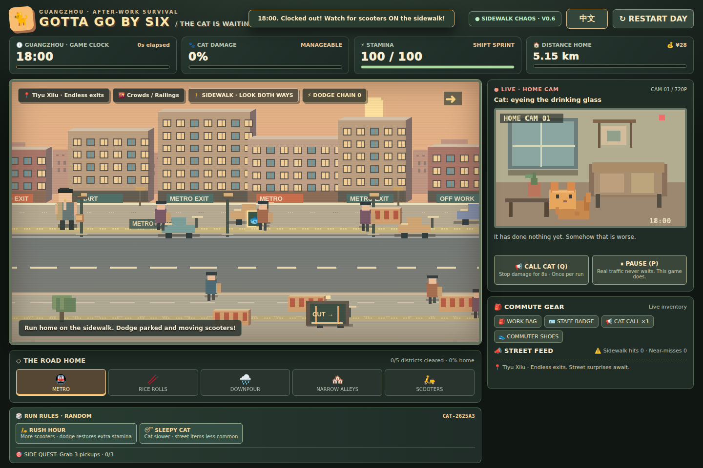
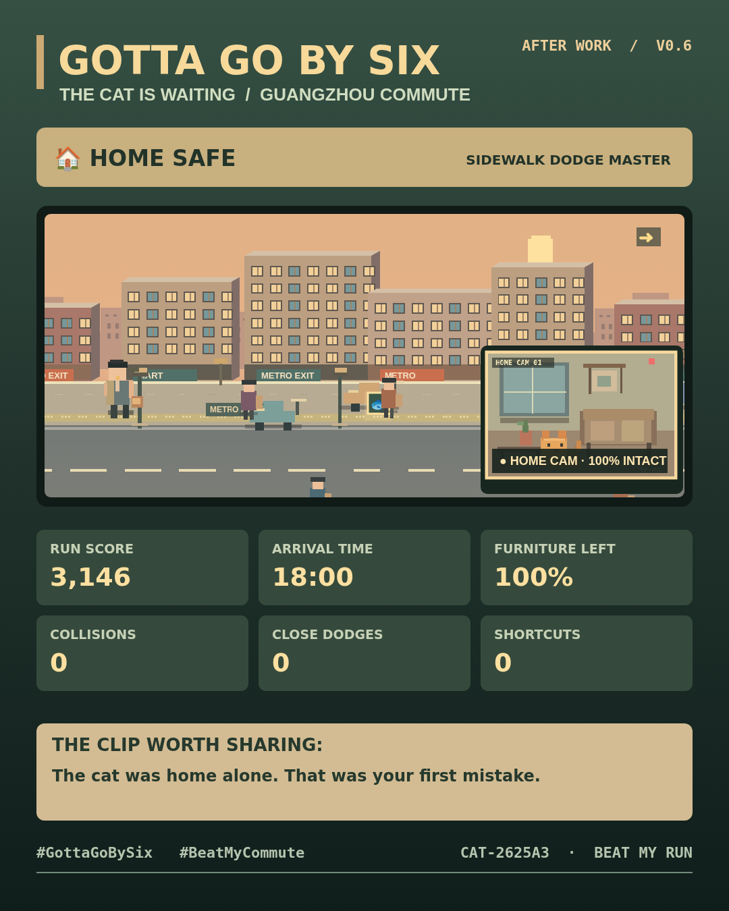

# 🐈 六点必须走 | Gotta Go by Six

> **老板不让你走，电鸡不让你过，猫不让家具活。**
>
> Your boss won't let you leave. Scooters won't let you walk. Your cat won't let your furniture live.

一款灵感来自广州街头通勤的 **中英双语、可反复游玩的轻量肉鸽小游戏**。玩家扮演下班回家的打工人，在经常被电动自行车占据的人行道上闪转腾挪，争分夺秒回家拯救家具。

**当前版本：** v0.6 可玩原型。仅使用 HTML + CSS + JavaScript，无需后端、构建工具或账号登录。

## 试玩方法

1. 下载仓库，双击打开 `index.html`。
2. 选择随机模式、每日挑战，或者输入朋友的 `CAT-XXXXXX` 挑战码。
3. 用方向键移动，躲避电鸡、汽车和积水，尝试赶在猫拆光家之前到家。

浏览器直接打开即可离线游玩；分享至社交平台时需要联网。

## 操作

| 按键 | 功能 |
|---|---|
| WASD / 方向键 | 移动 |
| Shift | 冲刺 |
| E | 与摊位、捷径等交互 |
| Q | 远程喊猫（次数有限） |
| P | 暂停 / 恢复 |
| R | 重新开始 |
| 1 / 2 | 事件二选一 |
| 手机屏幕 | 虚拟方向键与交互按钮 |

## 主要内容

- **人行道求生：** 停放挡路的电动自行车、逆行电鸡、身后鸣笛、汽车与积水。
- **猫拆家倒计时：** 一边赶路一边观察家庭监控，体力与家具完整度双重压力。
- **多局变化：** 城市/猫咪随机规则、路边拾取物、支线任务、摊位和捷径。
- **每日挑战：** 使用 UTC 日期生成每日共同地图。
- **好友挑战码：** 复制 `CAT-XXXXXX`，朋友可尝试同样的地图和随机规则。交通仿真随操作变化，并非逐帧相同。
- **极限闪避：** 连续险闪奖励、速度增益与戏剧性反馈。
- **可分享战报：** 1080×1350 PNG 图片、中文/英文结算文案、挑战码及社交分享入口。
- **语言切换：** 首次自动识别浏览器语言，其他语言以英文兜底，支持任意时刻手动切换。

## 结局分享

- 下载 PNG 分享图。
- X / Twitter 自动预填文字，需自己附上图片并确认发布。
- Instagram 可先保存图片、复制文案，再在 App 或网页中发布。
- 设备及浏览器支持时，可以调起系统原生分享菜单。
- 本地打开时适合分享挑战码；部署到 HTTPS 网站后才适合分享带挑战参数的可玩链接。

## 部署

这是纯静态游戏：将 `index.html` 放在静态网站根目录即可。不需要安装依赖或配置环境变量。如果准备使用 GitHub Pages，请确认已经决定公开发布该游戏，再自行启用 Pages。

## 注意

目前**没有**线上排行榜或在线多人对战。社交分享按钮仅打开对应平台的分享流程，不会替玩家直接发布帖子。个人最佳成绩和语言偏好仅保存在浏览器本地。

## 授权

MIT License，见 [LICENSE](LICENSE)。© 2026 [CNSleepybear](https://github.com/CNSleepybear)。